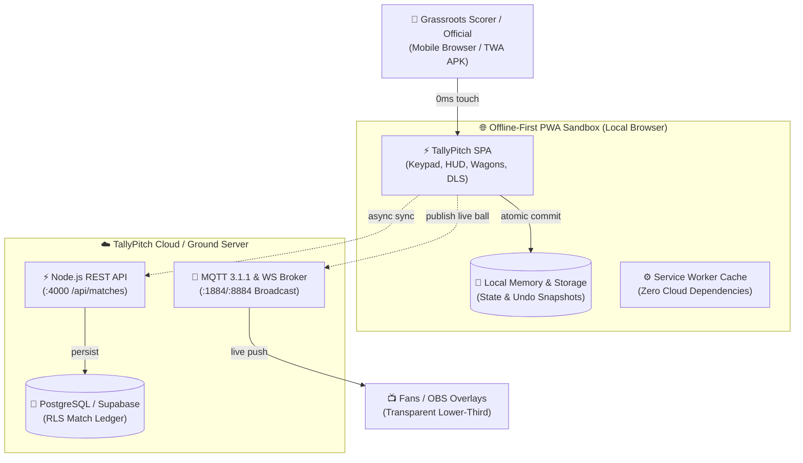
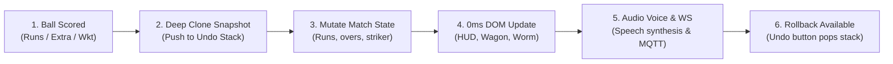
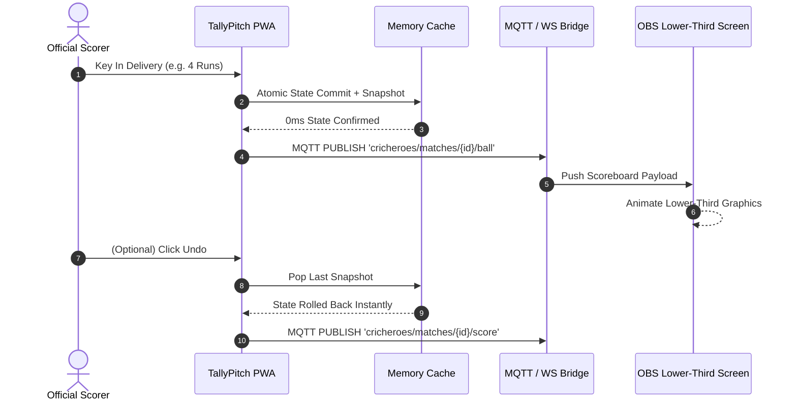
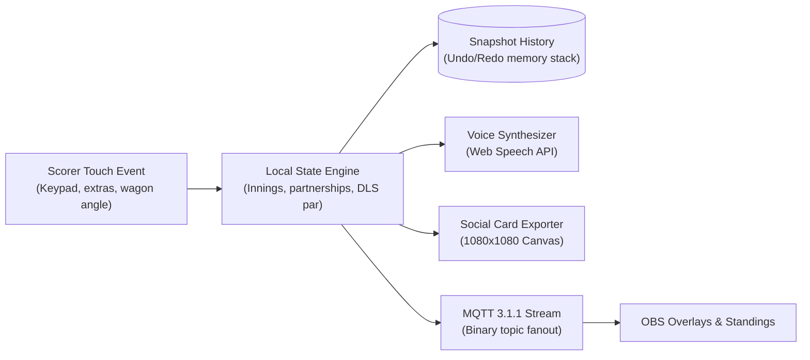
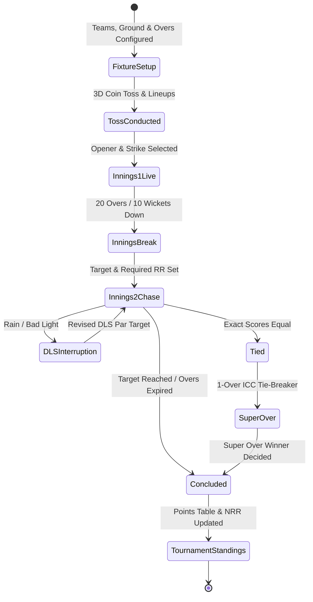

# Offline Resilience & Realtime Architecture

> **Executive Overview**: Production-grade grassroots cricket scoring platform, digital scorebook, and live OBS broadcast engine. Engineered with an offline-first architecture to guarantee 0ms latency scoring, zero dropped balls, instant atomic rollback, automated ICC Net Run Rate (NRR) computation, and real-time MQTT/WebSocket streaming.

All system architectures, scoring workflows, OBS sequence broadcasts, data pipelines, and match lifecycles are embedded below as native Mermaid diagrams with full architectural explanations.

---

## 🏛️ 1. System Architecture

### Architectural Breakdown & Component Responsibilities
* **Offline-First PWA Sandbox**: Grassroots matches are played in open municipal grounds and rural fields where 4G/5G signal frequently drops. TallyPitch runs locally in the scorer's browser cache via Service Worker, executing all cricket scoring rules with zero reliance on cloud connectivity.
* **Scoring Console & DOM HUD (`index.html`)**: Single-file high-contrast UI with daylight mode readability. Features full numeric keypad, extras selectors (Wide, No Ball, Bye, Leg Bye, Penalty), Wagon Wheel shot direction coordinates, and pitch trajectory maps.
* **In-Memory Snapshot Ring Buffer**: Every single scored delivery triggers an immutable deep clone of the match state pushed to an in-memory stack, enabling instantaneous, 0-millisecond single-click Undo without network roundtrips.
* **Node.js REST API & PostgreSQL**: Provides centralized match registration, tournament fixtures, official team rosters, and historical tournament points tables.
* **MQTT 3.1.1 & WebSocket Streaming Broker**: Low-latency message broker streaming live ball-by-ball updates to spectators and streaming OBS broadcast overlays in real time.
* **OBS Broadcast Overlay**: Standalone transparent webview (`/?overlay=true`) designed for live streaming overlays with dynamic animated lower-thirds, partnership worms, and striker stats.

---

## 🔄 2. Scoring Engine & 0ms Atomic Rollback Workflow

### Operational Workflow Stages
1. **Delivery Input**: Scorer taps a runs button, extras chip, or wicket modal button.
2. **Immutable Snapshot Push**: Before modifying state, a structured snapshot of `state.currentLive` is pushed onto the `undoStack`.
3. **State Mutation**: Deliveries count, total runs increment, striker/non-striker positions swap on odd runs, bowler statistics update, and over boundaries (6 legal balls) trigger automatic bowler change alerts.
4. **Instant HUD Refresh**: Total score, current run rate (CRR), required run rate (RRR), partnership runs, and wagon wheels re-render instantly at 0ms latency.
5. **Voice Commentary & Stream Publish**: Uses Web Speech API to speak the delivery score (e.g. *"Four runs to Rohit Sharma"*) and broadcasts the MQTT payload.
6. **Instant Rollback**: If an umpire signal is corrected or a scorer misclicks, tapping "Undo" pops the previous snapshot from the stack and restores match state with zero database roundtrips.

---

## ⚡ 3. Realtime Ingestion & OBS Broadcast Sequence

### Execution Sequence Details
* **Steps 1–3**: The scorer logs a boundary. The local state commits the delivery, updates batsman and bowler figures, and pushes the undo snapshot.
* **Step 4**: The PWA publishes a lightweight binary/JSON payload to the MQTT topic `cricheroes/matches/{id}/ball`.
* **Step 5–6**: The OBS stream browser source receives the payload over WebSocket, triggering CSS keyframe animations to display the boundary banner and updated total.
* **Steps 7–10**: When Undo is triggered, the rollback payload is published immediately to synchronize the OBS screen with the corrected score.

---

## 🌊 4. Match Data Flow Pipeline

### Data Pipeline Mechanics & Invariants
* **Deterministic Cricket Engine**: MCC Law compliance for extras (no ball re-bowls, free hits, byes, leg-byes, penalty runs under Laws 28.3, 41, and 42).
* **Automated DLS Par Calculator**: Mathematical Duckworth-Lewis-Stern resource table calculation for rain-curtailed run chases.
* **Social Matchday Exporter**: Direct client-side rendering to an HTML5 `<canvas>` producing high-resolution 1080x1080 social media match cards with player scores, wagon wheels, and team logos.

---

## ⏱️ 5. Match & Tournament Lifecycle

### Lifecycle State Machine Transitions
* **`FixtureSetup`**: Teams, venue dimensions, ball type (leather/tennis), and scheduled overs (T20, 10 overs) configured.
* **`TossConducted`**: Interactive 3D coin toss animation records toss winner and decision (bat/bowl).
* **`Innings1Live`**: Scorer tracks first innings balls, maidens, partnerships, and wagon placements until 10 wickets fall or overs expire.
* **`InningsBreak`**: Target score and required run rate (RRR) locked in.
* **`Innings2Chase`**: Live run chase tracking balls remaining vs. runs required. Supports mid-innings DLS rain adjustments.
* **`SuperOver`**: Official ICC 1-over tie-breaker mode activated if scores are level at the end of both innings.
* **`TournamentStandings`**: On match conclusion, Net Run Rate (NRR) is recomputed across the entire tournament points table using ICC rules: `NRR = (Total Runs Scored / Total Overs Faced) - (Total Runs Conceded / Total Overs Bowled)`.
