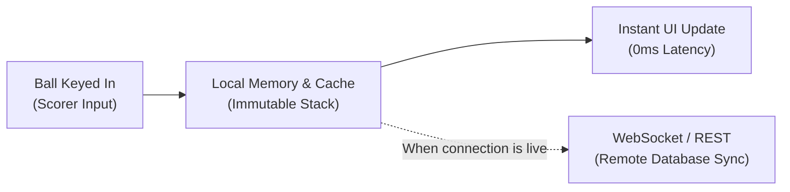
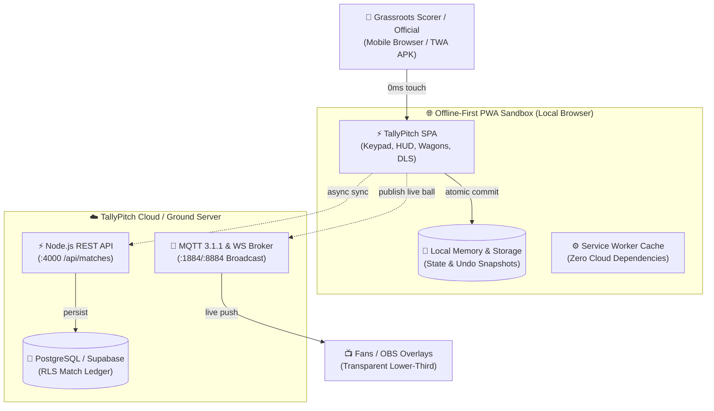
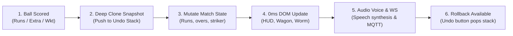
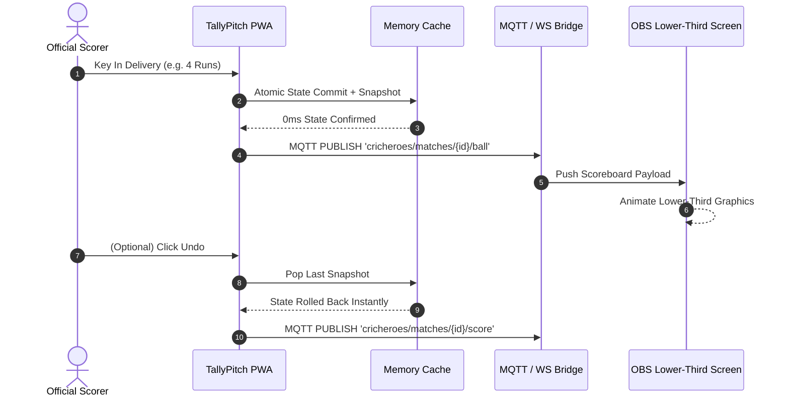
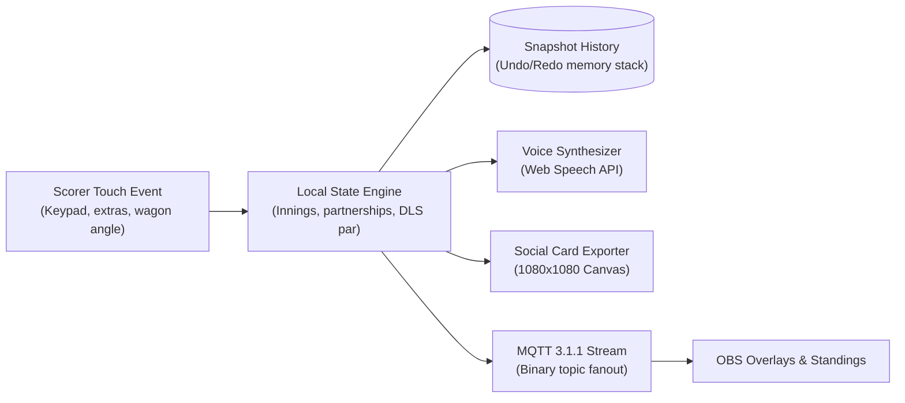
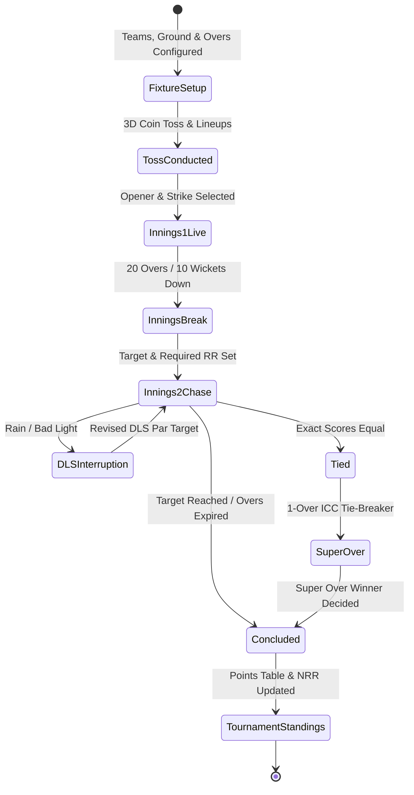

# Offline Resilience & Realtime Architecture

Grassroots cricket matches are frequently played on rural grounds, municipal parks, or farm pitches where cellular connectivity is intermittent or non-existent. Traditional cloud-first scoring apps freeze, lose deliveries, or drop connections. TallyPitch was built with an offline-first foundation.

---

## 1. Offline-First Lifecycle & Data Flow

1. **Local-First Write**: Every ball scored is immediately committed to in-memory state and local browser storage.
2. **0ms UI Feedback**: UI updates instantaneously; scorers never wait on network responses.
3. **Queue & Sync**: If a network connection is available, deliveries are transmitted asynchronously to the backend REST API (`POST /api/matches/:id/deliveries`).
4. **Offline Resilience**: If cellular signal drops completely, scoring continues uninterrupted for the full 20 overs. When back in range, the offline log can be synced to PostgreSQL.

---

## 2. Technology Stack & Component Responsibilities

| Layer | Technology | Primary Role |
| :--- | :--- | :--- |
| **Frontend** | Vanilla JS / Modular HTML / Tailored Tokens | Single-file zero-dependency scoring console and tournament dashboard (`index.html`). |
| **Styling** | Royal Pitch Sapphire Tokens (`tooltip.css`, tokens) | Daylight-readable high-contrast theme with dark-mode parity. |
| **Realtime Engine** | Node.js + `ws` (`server/realtime.js`) | Low-latency delivery broadcasting for spectators and live OBS overlays. |
| **REST API** | Node.js HTTP (`server/api.js`) | Match setup, squads, toss, deliveries, undo, and tournament points endpoints. |
| **Database** | PostgreSQL / Supabase (`supabase/migrations/`) | ACID relational data with Row-Level Security (RLS) policies. |
| **Billing** | Stripe (`server/stripe.js`) | Pro subscription handling and webhook processing. |

---

## 3. Formal System Visualizations

### 📐 1. System Architecture

### 🔄 2. Scoring Engine & 0ms Atomic Rollback Workflow

### ⚡ 3. Realtime Ingestion & OBS Broadcast Sequence

### 🌊 4. Match Data Flow Pipeline

### ⏱️ 5. Match & Tournament Lifecycle

